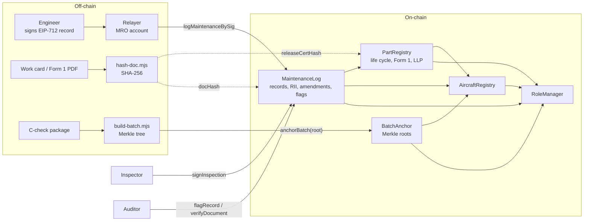
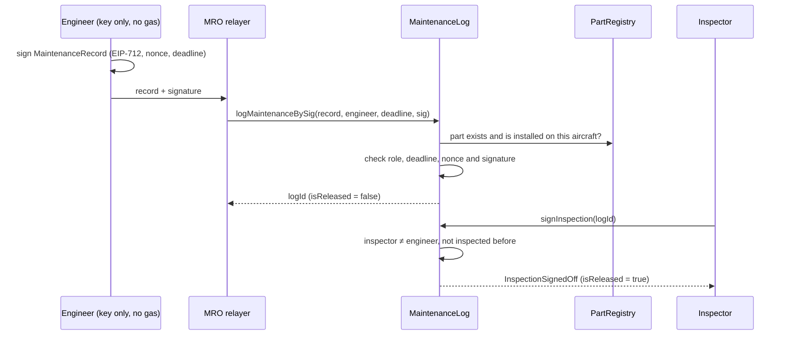
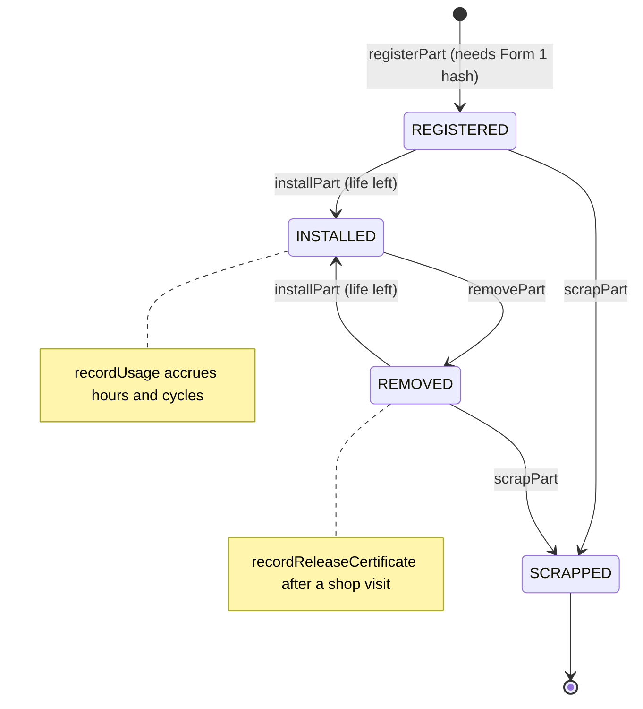

# Aviation On-Chain MRO

**Tamper-evident aircraft maintenance records and serialized part traceability, enforced by smart contracts.**

Aviation On-Chain MRO is a set of Solidity smart contracts, with off-chain tools, for recording aircraft **Maintenance, Repair and Overhaul (MRO)** on an EVM blockchain. It registers aircraft and serialized parts, enforces each part's life cycle (a scrapped part can never return to service, and a part past its life limit cannot be installed), and keeps an append-only maintenance log in which every entry is signed by an accountable engineer, carries the SHA-256 fingerprint of its supporting document and, for Required Inspection Items, is not released until a second, independent inspector signs it off.

The guiding principle: **every rule that keeps an unairworthy part off an aircraft is enforced by code, and every record can be checked by anyone who holds the original document.** The chain does not replace an MRO's quality system; it makes its records impossible to quietly edit after the fact.

Built with **Solidity 0.8.24, Foundry and OpenZeppelin Contracts v5**. 84 tests (unit, fuzz and invariant), CI on every push.

---

## Contents

1. [Problem statement](#1-problem-statement)
2. [Solution overview](#2-solution-overview)
3. [Target users](#3-target-users)
4. [Features](#4-features)
5. [How it works](#5-how-it-works)
6. [Repository structure](#6-repository-structure)
7. [Roles and permissions](#7-roles-and-permissions)
8. [Part life cycle](#8-part-life-cycle)
9. [Airworthiness controls](#9-airworthiness-controls)
10. [Cryptographic traceability](#10-cryptographic-traceability)
11. [Contract reference](#11-contract-reference)
12. [Off-chain tools](#12-off-chain-tools)
13. [Getting started](#13-getting-started)
14. [Demo walkthrough](#14-demo-walkthrough)
15. [Testing](#15-testing)
16. [Gas costs and contract sizes](#16-gas-costs-and-contract-sizes)
17. [Design decisions](#17-design-decisions)
18. [Regulatory context](#18-regulatory-context)
19. [Limitations and threat model](#19-limitations-and-threat-model)
20. [Roadmap](#20-roadmap)
21. [Author](#author)

---

## 1. Problem statement

Every part on a commercial aircraft must be traceable by serial number, from the manufacturer's release certificate to the day it is scrapped, and every piece of maintenance must be recorded by a licensed person, against the right aircraft and the right part, with the supporting work card. Regulators and operators depend on those records to decide whether an aircraft is airworthy.

In practice the records are spread across operators, MROs, part brokers and paper or PDF archives. Three problems follow:

* **Records can be edited.** A database row or a scanned work card can be altered after the fact, and an audit cannot easily prove that it was not.
* **Unapproved and counterfeit parts.** A part that was scrapped, has no valid release certificate or has used up its life can re-enter the supply chain with paperwork that looks correct.
* **Sign-off is hard to verify.** Who actually approved a task, and whether a required independent inspection really happened, is often recorded only by a signature on paper.

The question this project explores is: **which of those guarantees can a public, append-only ledger enforce in code, and what does that cost?**

## 2. Solution overview

The system is five contracts that share one role registry:

* **`RoleManager`**: who may do what (Admin, MRO, Engineer, Inspector, Auditor).
* **`AircraftRegistry`**: aircraft by registration mark (e.g. `5Y-ABC`), model and operator.
* **`PartRegistry`**: serialized parts, their life cycle, release certificates and life limits.
* **`MaintenanceLog`**: the append-only maintenance record, with EIP-712 engineer signatures, SHA-256 document fingerprints, amendments, independent inspections and auditor flags.
* **`BatchAnchor`**: anchors a whole maintenance package (for example a C-check with hundreds of task cards) as a single Merkle root.

Three small Node.js tools sit beside them: one fingerprints a document, one builds the Merkle tree for a maintenance package, and one lets an engineer sign a record off-chain and have it relayed, so engineers never need gas.

## 3. Target users

* **Maintenance organisations (MROs)** and airline engineering departments: a shared, tamper-evident record of what was done to which part on which aircraft, by whom.
* **Licensed engineers and inspectors**: sign-off with their own key, without handling transactions or cryptocurrency.
* **Quality and compliance auditors**, internal or from a civil aviation authority: verify a work card or release certificate against the record, and flag entries for review.
* **Lessors and part buyers**: check a part's history, certificate and remaining life before accepting it.

The intended deployment for real fleets is a **permissioned EVM network** run by a consortium of these parties; the contracts run unchanged on a public testnet or a local Anvil node for development.

## 4. Features

* **Role-based access control** with five roles; the last admin can never be removed, so the system cannot be locked out.
* **Serialized part traceability.** Parts are identified by manufacturer + part number + serial number, because serial numbers are only unique per manufacturer and part number.
* **Enforced life cycle.** A scrapped part can never be reinstalled; an installed part must be removed before it is scrapped; a part is on at most one aircraft.
* **Release certificates.** A part cannot be registered without the SHA-256 of its EASA Form 1 / FAA 8130-3, and a new certificate is recorded after each shop visit.
* **Life-limited parts.** Hour and cycle limits, usage recorded per flight or per day for many parts at once, and installation blocked once a limit is reached.
* **Append-only maintenance log.** Entries are never edited or deleted; corrections are amendments that point to the original.
* **Maintenance must match reality.** On-wing work must reference a part installed on that aircraft; off-wing shop work cannot target an installed or scrapped part.
* **Required Inspection Items (dual sign-off).** RII work is not released until an independent inspector signs it; an engineer can never inspect their own work.
* **Gasless engineer sign-off (EIP-712).** Engineers sign typed records off-chain; anyone can relay them. Nonces and deadlines prevent replay; smart-contract wallets (ERC-1271) are supported.
* **Document verification.** Every record stores the SHA-256 of its work card; anyone with the file can prove it is the one that was signed off.
* **Merkle batch anchoring.** A maintenance package of any size is anchored for the cost of one transaction, and any single task card can be proven to belong to it.
* **Auditor flags.** Auditors can permanently and publicly flag a record for review.
* **Events for every action**, indexed by part ID, aircraft ID and actor, for off-chain indexing.

## 5. How it works



A typical Required Inspection Item, signed off-chain and relayed:



## 6. Repository structure

```
aviation-onchain-mro/
├── src/
│   ├── RoleManager.sol             roles: Admin, MRO, Engineer, Inspector, Auditor
│   ├── AircraftRegistry.sol        aircraft by registration mark
│   ├── PartRegistry.sol            part life cycle, release certificates, life-limited parts
│   ├── MaintenanceLog.sol          append-only log, EIP-712 sign-off, RII, amendments, flags
│   └── BatchAnchor.sol             Merkle-root anchoring of maintenance packages
├── test/
│   ├── AviationMRO.t.sol           roles, registries, life cycle, maintenance log (unit + fuzz)
│   ├── Cryptography.t.sol          EIP-712, ERC-1271, document and Merkle tests
│   ├── Airworthiness.t.sol         release certificates, life-limited parts, RII
│   └── PartLifecycle.invariant.t.sol  invariants under random install/remove/scrap/flying
├── script/
│   └── Deploy.s.sol                DeployScript (any network) + DemoScript (local Anvil)
├── tools/                          Node.js helpers
│   ├── hash-doc.mjs                SHA-256 of a document
│   ├── build-batch.mjs             Merkle tree + proofs for a maintenance package
│   ├── sign-record.mjs             EIP-712 signing, optional relay
│   └── examples/                   sample 5-task C-check package and its generated tree
├── lib/                            forge-std, OpenZeppelin Contracts v5.4.0 (git submodules)
├── .github/workflows/test.yml      CI: format, build, tests, Merkle tool check
├── foundry.toml                    solc 0.8.24, optimizer, fuzz/invariant profiles
├── remappings.txt
└── LICENSE
```

## 7. Roles and permissions

| Action | Admin | MRO | Engineer | Inspector | Auditor | Anyone |
|---|:-:|:-:|:-:|:-:|:-:|:-:|
| Grant / revoke roles | ✓ | | | | | |
| Register aircraft | ✓ | ✓ | | | | |
| Register, install, remove, scrap parts | ✓ | ✓ | | | | |
| Record release certificate, record usage | ✓ | ✓ | | | | |
| Log or amend maintenance (own transaction) | ✓ | ✓ | ✓ | | | |
| Sign a maintenance record off-chain (EIP-712) | ✓ | ✓ | ✓ | | | |
| Relay a signed record | | | | | | ✓ |
| Sign off a Required Inspection Item | | | | ✓ (not own work) | | |
| Flag a record for review | | | | | ✓ | |
| Anchor a maintenance package | ✓ | ✓ | | | | |
| Read and verify anything | | | | | | ✓ |

* The **last admin cannot be revoked** (`LastAdmin`), so the system can never be left without an administrator.
* A signer must **still hold a valid role when the record is submitted**, so revoking an engineer also invalidates their unsubmitted signatures.
* One person may hold several roles, but the inspection check compares people, not roles: an engineer who is also an inspector still cannot inspect their own work.

## 8. Part life cycle



| Rule | Enforced by |
|---|---|
| A part needs a release certificate to be registered | `EmptyCertificate` |
| The same manufacturer + part number + serial cannot be registered twice | `PartExists` |
| A scrapped part can never be reinstalled (SCRAPPED is terminal) | `PartIsScrapped` |
| An installed part must be removed before scrapping, so the aircraft history shows the removal | `MustRemoveBeforeScrap` |
| A part is on at most one aircraft at a time | `AlreadyInstalled` |
| A part can only be removed from the aircraft it is on | `NotInstalledOnThatAircraft` |
| A part at or past its hour or cycle limit cannot be installed | `LifeLimitReached` |
| Usage can only be recorded on installed parts | `NotInstalled` |
| A new release certificate can only be recorded while the part is off-wing | `CertificateWhileInstalled` |
| On-wing maintenance must reference a part installed on that aircraft | `PartNotOnAircraft` |
| Shop work (`aircraftId = 0`) cannot target an installed or scrapped part | `PartNotAvailableForShopWork` |

## 9. Airworthiness controls

### Release certificates (EASA Form 1 / FAA 8130-3)

`registerPart` requires `releaseCertHash`, the SHA-256 of the part's authorised release certificate. `verifyReleaseCertificate(partId, hash)` tells anyone holding a certificate file whether it is the one on record. After an overhaul the shop issues a new certificate; `recordReleaseCertificate(partId, hash)` stores it (only while the part is off-wing, never for a scrapped part), and every earlier certificate stays in the `ReleaseCertificateRecorded` event history.

### Life-limited parts (LLP)

Parts such as engine disks and landing-gear components have hard limits. Each part can carry an **hour limit** and/or a **cycle limit** (0 means no limit), plus **hours and cycles since new**, so a used part can enter the registry with its real history.

* `recordUsage(partIds, flightHours, flightCycles)` applies one flight, or one day of flying, to every listed installed part in one call.
* Usage is **recorded as flown, even past a limit**, so the record stays truthful; `LifeLimitExceeded` is emitted the moment a limit is reached.
* A part at or past either limit **cannot be installed** (`LifeLimitReached`). It can still be removed and scrapped.
* `remainingLife(partId)` returns hours and cycles left (`type(uint32).max` for an unlimited dimension); `isLifeExpired(partId)` returns a yes/no.

### Required Inspection Items (dual sign-off)

Some tasks, such as flight-control rigging or engine mount torque, need a second, independent inspection before the aircraft may be released.

* A record created with `requiresInspection = true` is **not released** (`isReleased(logId) == false`) until a holder of `INSPECTOR_ROLE` calls `signInspection(logId)`.
* The inspector must be **a different person** from the engineer (`CannotInspectOwnWork`), even if the engineer also holds the inspector role.
* A record can be inspected once (`AlreadyInspected`); a record that does not need inspection cannot be "inspected" (`InspectionNotRequired`).
* **Amending an RII record creates an entry that needs its own new inspection**, so a correction cannot slip past the inspector.
* `requiresInspection` is part of the signed EIP-712 record, so a relayer cannot remove it.

## 10. Cryptographic traceability

| Mechanism | What it proves | Where |
|---|---|---|
| **SHA-256 document hashes** | A work card or PDF is byte-for-byte the document that was signed off | `MaintenanceLog.verifyDocument` |
| **SHA-256 certificate hashes** | A release certificate is the one on record for that part | `PartRegistry.verifyReleaseCertificate` |
| **EIP-712 typed signatures** | A specific engineer approved exactly this record (aircraft, part, action, document, RII flag) | `MaintenanceLog.logMaintenanceBySig` |
| **Nonces + deadlines** | A signature can be used once, and only before it expires | OpenZeppelin `Nonces` |
| **ERC-1271** | Sign-off can come from a smart-contract wallet (e.g. an MRO multisig or a hardware-backed account) | OpenZeppelin `SignatureChecker` |
| **Merkle batch anchoring** | A task card belongs to an anchored maintenance package, without revealing the rest | `BatchAnchor.verifyItem` |
| **Hash-keyed identities** | Part IDs bind manufacturer, part number and serial without collisions (`abi.encode`, not `encodePacked`) | `PartRegistry.partKey` |

### Gasless engineer sign-off (EIP-712)

The engineer signs the record with their own key: no transaction and no gas. Anyone, typically the MRO's relayer, submits it with `logMaintenanceBySig`. The record stores both the accountable **`engineer`** and the **`submitter`**; authority comes from the signature, not from whoever sends the transaction.

```
MaintenanceRecord(uint256 aircraftId,bytes32 partId,string action,bytes32 docHash,string docUri,bool requiresInspection,uint256 nonce,uint256 deadline)
Domain: name "AviationMRO MaintenanceLog", version "1", chainId, verifyingContract
```

`recordDigest(record, nonce, deadline)` returns the exact digest to sign, and `nonces(engineer)` returns the next nonce.

### Merkle batch anchoring

A C-check can produce hundreds of task cards. Instead of one transaction each, the MRO builds a Merkle tree of the package and anchors only its root. Leaves use the OpenZeppelin `StandardMerkleTree` encoding, so trees built with the standard JavaScript library verify on-chain unchanged:

```
leaf = keccak256(bytes.concat(keccak256(abi.encode(partId, taskRef, docHash))))
```

Anchoring costs the same for 5 task cards or 5,000 (see [Gas costs](#16-gas-costs-and-contract-sizes)). A test checks every proof generated by `tools/build-batch.mjs` against the contract, and CI regenerates the example tree to make sure the tool and the contract stay in sync.

## 11. Contract reference

### `RoleManager`

| Function | Purpose |
|---|---|
| `grantRole(role, account)` / `revokeRole(role, account)` | Admin only; revoking the last admin reverts |
| `hasRole(role, account)` | Role check used by every other contract |
| `ADMIN_ROLE`, `MRO_ROLE`, `ENGINEER_ROLE`, `INSPECTOR_ROLE`, `AUDITOR_ROLE`, `adminCount` | Constants and state |

### `AircraftRegistry`

| Function | Purpose |
|---|---|
| `registerAircraft(registration, model, operatorName)` | Returns `aircraftId`; duplicate registration marks revert |
| `getAircraft(aircraftId)`, `exists(aircraftId)`, `aircraftIdByRegHash(hash)` | Lookups |

### `PartRegistry`

| Function | Purpose |
|---|---|
| `registerPart(PartInput)` | Returns `partId`; requires a release-certificate hash; optional life limits and history |
| `installPart(aircraftId, partId)` / `removePart(aircraftId, partId)` / `scrapPart(partId)` | Life cycle (rules in section 8) |
| `recordReleaseCertificate(partId, certHash)` | New certificate after a shop visit (off-wing only) |
| `recordUsage(partIds[], flightHours, flightCycles)` | Accrue usage on installed parts |
| `partKey(manufacturer, partNumber, serialNumber)` | Deterministic part ID |
| `getPart`, `partExists`, `statusOf`, `isInstalledOn`, `remainingLife`, `isLifeExpired`, `verifyReleaseCertificate` | Views |

`PartInput` = `{ partNumber, serialNumber, manufacturer, releaseCertHash, hourLimit, cycleLimit, hoursSinceNew, cyclesSinceNew }`.

### `MaintenanceLog`

| Function | Purpose |
|---|---|
| `logMaintenance(Record)` | Log as the transaction sender |
| `logMaintenanceBySig(Record, engineer, deadline, signature)` | Submit an engineer's off-chain EIP-712 signature |
| `amendMaintenance(originalLogId, action, docHash, docUri)` | Append a correction; the original is unchanged |
| `signInspection(logId)` | Independent RII sign-off |
| `flagRecord(logId, reason)` | Auditor flag (permanent, public) |
| `verifyDocument(logId, docHash)`, `isReleased(logId)` | Verification |
| `get(logId)`, `count()`, `amendmentsOf(logId)`, `flagged(logId)`, `nonces(account)`, `recordDigest(...)`, `domainSeparator()` | Views |

`Record` = `{ aircraftId, partId, action, docHash, docUri, requiresInspection }`; `aircraftId = 0` means off-wing shop work.

### `BatchAnchor`

| Function | Purpose |
|---|---|
| `anchorBatch(aircraftId, root, leafCount, uri)` | Anchor a package root (`aircraftId = 0` for shop packages) |
| `verifyItem(batchId, partId, taskRef, docHash, proof)` | Prove a task card is in the package |
| `leafHash(partId, taskRef, docHash)`, `get(batchId)`, `count()` | Helpers and views |

### Events

| Contract | Events |
|---|---|
| `RoleManager` | `RoleGranted`, `RoleRevoked` |
| `AircraftRegistry` | `AircraftRegistered` |
| `PartRegistry` | `PartRegistered`, `ReleaseCertificateRecorded`, `LifeLimitsSet`, `PartInstalled`, `PartRemoved`, `PartScrapped`, `UsageRecorded`, `LifeLimitExceeded` |
| `MaintenanceLog` | `MaintenanceLogged`, `MaintenanceAmended`, `InspectionSignedOff`, `RecordFlagged` |
| `BatchAnchor` | `BatchAnchored` |

Part IDs, aircraft IDs and actors are `indexed`, so an indexer can filter the full history of one part or one aircraft.

## 12. Off-chain tools

Node.js 18+; run `npm install` inside `tools/` once.

```bash
# SHA-256 of a document: the on-chain docHash or releaseCertHash (same result as sha256sum)
node tools/hash-doc.mjs workcard.pdf

# Merkle tree for a maintenance package -> root, leaf count and a proof per task card
node tools/build-batch.mjs tools/examples/c-check-package.json out.json

# Engineer signs a record off-chain; --relay submits it with RELAYER_KEY
ENGINEER_KEY=0x.. RELAYER_KEY=0x.. RPC_URL=http://127.0.0.1:8545 MAINTENANCE_LOG=0x.. \
  node tools/sign-record.mjs record.json --relay
```

`record.json`:

```json
{ "aircraftId": 1, "partId": "0x..", "action": "Engine compressor wash",
  "docHash": "0x..", "docUri": "ipfs://Qm...", "requiresInspection": false }
```

Maintenance package input for `build-batch.mjs`: a JSON array of `{ "partId", "taskRef", "docHash" }` (see `tools/examples/c-check-package.json`).

## 13. Getting started

### Prerequisites

* [Foundry](https://book.getfoundry.sh/getting-started/installation) (`forge`, `anvil`, `cast`)
* Git
* Node.js 18+ (only for `tools/`)

### Clone and build

```bash
git clone --recursive https://github.com/bmitigoa/aviation-onchain-mro.git
cd aviation-onchain-mro
forge build
```

If you cloned without `--recursive`, run `git submodule update --init --recursive` to fetch `lib/`.

### Run the tests

```bash
forge test                       # all 84 tests
forge test --gas-report          # with gas per function
FOUNDRY_PROFILE=ci forge test    # more fuzz and invariant runs, as in CI
```

### Deploy

```bash
forge script script/Deploy.s.sol:DeployScript --rpc-url <RPC_URL> --private-key <KEY> --broadcast
```

The deploying account becomes the initial admin. It then grants the MRO, Engineer, Inspector and Auditor roles with `grantRole`.

## 14. Demo walkthrough

Run the full workflow on a local chain:

```bash
anvil                                                                         # terminal 1
forge script script/Deploy.s.sol:DemoScript --rpc-url http://127.0.0.1:8545 --broadcast   # terminal 2
```

The demo uses Anvil's default development accounts (#0 admin, #1 MRO and relayer, #2 engineer, #3 auditor, #4 inspector):

1. Admin deploys the five contracts and assigns the roles.
2. MRO registers aircraft `5Y-ABC`.
3. MRO registers an engine and a life-limited HPT disk (20,000-cycle limit, 1,250 cycles already used), each with its Form 1 hash, and installs both.
4. The engineer **signs a Required Inspection Item off-chain**; the MRO relays it, so the engineer pays no gas.
5. MRO anchors a 5-task C-check package as one Merkle root.
6. The engineer corrects the record with an amendment; the original stays unchanged.
7. An independent inspector signs off the RII, releasing the work.
8. MRO records a day of flying (6 hours, 4 cycles) on the installed parts.
9. The auditor flags the original entry for review.

Expected output (end of the script):

```
Log entries       2
Doc rev A valid   true
RII released      true
Disk cycles left  18746
```

## 15. Testing

| Suite | Tests | Covers |
|---|---|---|
| `AviationMRO.t.sol` | 40 | roles (incl. last-admin protection), aircraft and part registries, life cycle, maintenance log, amendments, auditor flags, events, fuzzed access control and part-ID collision checks |
| `Cryptography.t.sol` | 19 | EIP-712 digest against the spec, relayed signatures, replay, expiry, tampering, wrong signer, revoked engineer, ERC-1271 wallet, fuzzed wrong keys, document verification, Merkle proofs from the JS tool |
| `Airworthiness.t.sol` | 22 | release certificates, life-limited parts (accrual, batch usage, expiry, blocked install, fuzzed limits), RII (release gate, own-work rule, amendments) |
| `PartLifecycle.invariant.t.sol` | 3 invariants | under random install / remove / scrap / flying sequences: a scrapped part stays scrapped and off-wing; `installedAircraftId` is set if and only if the part is installed; a part at or past its life limit is never installed |

**84 tests, all passing.** CI (GitHub Actions, `.github/workflows/test.yml`) runs on every push and pull request: `forge fmt --check`, `forge build --sizes`, `forge test` under the `ci` profile (1,000 fuzz runs; 256 invariant runs × depth 128), and a check that `tools/build-batch.mjs` still produces the committed example tree exactly.

The demo script and `tools/sign-record.mjs` were also run end to end against a local Anvil node: a record signed in JavaScript was relayed and accepted, `verifyDocument` returned `true` for the original file and `false` after a one-character edit, and an RII record stayed unreleased until an inspector signed it.

## 16. Gas costs and contract sizes

Measured with `forge test --gas-report` (solc 0.8.24, optimizer 200 runs). Figures are the highest observed for a successful call in the test suite, which includes first writes to empty storage; repeat calls are usually cheaper.

| Operation | Gas (up to) |
|---|---|
| `registerAircraft` | 172,715 |
| `registerPart` (with certificate and life limits) | 187,263 |
| `installPart` | 88,927 |
| `recordUsage` (per call) | 63,823 |
| `logMaintenance` | 263,969 |
| `logMaintenanceBySig` (signature check included) | 279,613 |
| `signInspection` | 39,717 |
| `amendMaintenance` | 282,065 |
| `flagRecord` | 56,198 |
| `anchorBatch` (any number of task cards) | 175,816 |
| `verifyItem` (Merkle proof, view) | 6,737 |
| `verifyDocument` (view) | 4,766 |

**Batching pays off quickly.** Logging 5 task cards one by one costs up to about 1.3 million gas; anchoring the same package as a Merkle root costs about 176,000, and that figure does not grow with the size of the package.

| Contract | Runtime size (bytes) | Deployment gas |
|---|---|---|
| `RoleManager` | 1,570 | 443,579 |
| `AircraftRegistry` | 3,796 | 874,840 |
| `BatchAnchor` | 3,542 | 820,578 |
| `PartRegistry` | 7,537 | 1,684,318 |
| `MaintenanceLog` | 9,885 | 2,203,882 |

All contracts are well under the 24,576-byte EIP-170 limit.

## 17. Design decisions

* **Events first, minimal storage.** Full history (every certificate, every usage record, every role change) lives in indexed events; storage keeps only the current state that rules need to check.
* **Append-only, never edit.** Maintenance records cannot be changed or deleted. Corrections are amendments that point to the original, which is how paper maintenance records are corrected too.
* **Hashes on-chain, documents off-chain.** Work cards and certificates stay in the MRO's document system or on IPFS; only their SHA-256 goes on-chain. SHA-256 was chosen over keccak256 for documents because any auditor can reproduce it with `sha256sum`.
* **Record usage truthfully.** Usage past a life limit is still recorded (with an alert) rather than rejected, because the flights happened; what the contract refuses is putting such a part back on an aircraft.
* **Structs for inputs.** `PartInput` and `Record` keep the external API readable and avoid Solidity's stack-depth limits as fields grow.
* **Battle-tested cryptography.** EIP-712, signature checking (including ERC-1271), nonces and Merkle proofs come from OpenZeppelin Contracts v5 rather than hand-written code.
* **Separate contracts, one role registry.** Each contract has one job and they share `RoleManager`, so a role change takes effect everywhere at once.

## 18. Regulatory context

The contracts model concepts from aviation maintenance regulation. They are a research prototype, **not a certified or approved system**, and are not a substitute for an organisation's approved procedures.

| Concept | Where it comes from | In this project |
|---|---|---|
| Authorised release certificate | EASA Form 1; FAA Form 8130-3 (Airworthiness Approval Tag) | `releaseCertHash`, `recordReleaseCertificate`, `verifyReleaseCertificate` |
| Maintenance records | EASA Part-145 / Part-CAMO record-keeping; FAA 14 CFR Part 43 (§ 43.9) | Append-only `MaintenanceLog`, document hashes, amendments |
| Required Inspection Items | FAA 14 CFR § 121.369 (air carrier maintenance programmes) | `requiresInspection`, `INSPECTOR_ROLE`, `signInspection` |
| Life-limited parts | Manufacturer airworthiness limitations, tracked in hours and cycles | `hourLimit`, `cycleLimit`, `recordUsage`, `LifeLimitReached` |
| Independent audit | Quality / compliance monitoring and authority audits | `AUDITOR_ROLE`, `flagRecord`, public verification |

## 19. Limitations and threat model

* **Garbage in, garbage out.** The chain proves *who* recorded *what* and *when*. It cannot prove that the physical work was done correctly, or that a document's contents are true. It complements an MRO's quality system; it does not replace it.
* **Key custody.** Security depends on engineers and inspectors protecting their signing keys. Contract wallets (ERC-1271) allow multisig or hardware-backed keys; key loss and recovery procedures are outside the contracts.
* **Usage is reported, not measured.** Flight hours and cycles come from the MRO or operator; integrating them directly from aircraft or flight-operations systems is future work.
* **Admin trust.** Admins grant roles, so the consortium must trust its admins; a multisig admin is recommended for any real deployment.
* **Timestamps** come from block producers and are accurate to seconds, not milliseconds.
* **Confidentiality.** On a public chain, part histories and fleet activity are visible to anyone. Only hashes and short descriptions are stored, but commercially sensitive fleets should use a permissioned EVM network.
* **Calendar limits are not modelled.** Shelf life and calendar-based limits (in addition to hours and cycles) are not yet supported.
* **Inspector sign-off is a direct transaction.** Inspectors cannot yet sign off-chain and be relayed the way engineers can.
* **Not audited.** The contracts have extensive tests but have not had an independent security audit.

## 20. Roadmap

1. ~~**Lifecycle enforcement and append-only records**~~: done (scrapped is terminal, removal before scrap, amendments, auditor flags).
2. ~~**Cryptographic sign-off**~~: done (EIP-712, ERC-1271, nonces and deadlines, SHA-256 documents, Merkle batches).
3. ~~**Release certificates, life-limited parts and RII dual sign-off**~~: done.
4. **Testnet deployment** with verified contracts and published addresses.
5. **Inspector sign-off by EIP-712 signature**, using the same relayer flow as engineers.
6. **Calendar-limited parts** and shelf-life tracking.
7. **Auditor dashboard**: enter a serial number and see the part's full history, certificates and remaining life.
8. **QR / NFC tags** linking a physical part to its on-chain record.
9. **IPFS pinning** for maintenance documents.
10. **Permissioned network deployment** (e.g. Hyperledger Besu) for an operator/MRO consortium.

---

## Author

**Baraka Mitigoa**, Nairobi, Kenya
Aeronautical engineering background; MSc Computing and Information Systems, Strathmore University
GitHub: [@bmitigoa](https://github.com/bmitigoa) · ORCID: [0009-0004-0349-2917](https://orcid.org/0009-0004-0349-2917)

Independent research into cryptographic traceability for safety-critical infrastructure.

## Licence

MIT — see [LICENSE](LICENSE).
